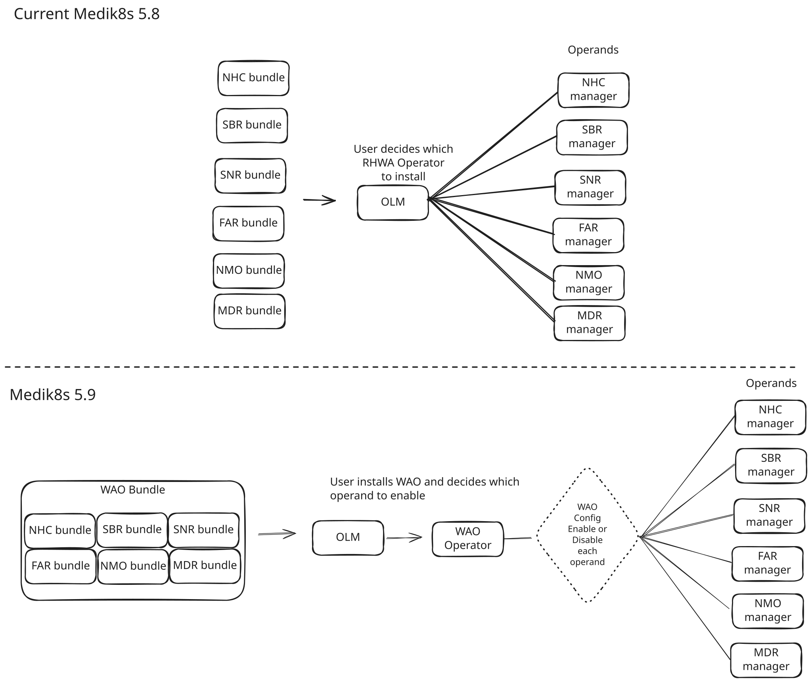

# Overview of Workload Availability Operator

The Workload Availability Operator (WAO) packages six medik8s operators as one
installation. It intends to simplify publishing and installation while preserving
the existing behavior.

This document explains the design and how to work with it. 

## Goal
Medik8s 5.9 published as a single operator.
Need to work over next month to learn if there are any blockers that would prevent this.

## High Level Understanding

 
### WAO is a single operator that manages operands

WAO treats the existing medik8s operators as **operands** which are managed by the WAO operator.

WAO is responsible for:
- **CRDs** - Collecting all of the operand CRDs and packaging so OLM will deploy.
  - This means that all of the operand CRDs are installed into the cluster at time of WAO installation.
  - CRDs are NOT gated on the WAO operator's `enabled` state.
- **RBAC** - Collecting all of the operand RBAC related files and packaging in the WAO bundle so OLM will deploy on install of WAO.
- **Runtime manifests** - Understanding the runtime manifests for each operand and deploying them when the operand is `enabled`.
  - and...cleaning them up when the operand is `disabled`.

WAO is **not** responsible for the business logic of each operand.
- Each operand will continue to be developed in its own repository.
- Operand changes are intended to be minimal to none
  - As of today we have not made any changes to any of the operands, yet its likely will want to refactor the webhooks soon to allow them to be brought into the main WAO manager process.

### Recap of responsibilities: OLM - WAO - Operand
- **OLM**
  - On install of WAO
    - Deploys all CRDs (including all operand CRDs and WAO's CRDs)
    - Deploys all RBAC (including all operand RBAC and WAO's RBAC)
    - Deploys the WAO operator
- **WAO**
  - On enable
    - Deploys the operand's runtime manifests
  - On disable
    - Removes the operand's runtime manifests
- **Operand**
  - Responsible for reconciling its CRs
  - Currently runs their own webhook server, we likely will want to move this to run in the main WAO manager process.

### What does install of WAO look like?

1. Install the WAO operator via OLM
2. The WAO operator creates the `WorkloadAvailabilityConfig` CR called `cluster` on bootstrap
    - Only one instance of a `WorkloadAvailabilityConfig` is allowed as per validation in the `WorkloadAvailabilityConfig` CRD
3. All operands are set to be disabled by default
4. User needs to enable operands 
5. After enabling operands, the WAO operator will reconcile the operand's runtime manifests
  6. It will create the Deployment, Service, ConfigMaps, and Webhooks of the operand.

#### How does a user enable/disable an operand?

Edit the `WorkloadAvailabilityConfig` CR called `cluster` to enable or disable an operand.

See [/config/samples/workloadavailability_v1alpha1_workloadavailabilityconfig.yaml](/config/samples/workloadavailability_v1alpha1_workloadavailabilityconfig.yaml)
```yaml
apiVersion: workloadavailability.medik8s.io/v1alpha1
kind: WorkloadAvailabilityConfig
metadata:
  name: cluster
spec:
  components:
    nodeHealthCheck:
      enabled: false
    selfNodeRemediation:
      enabled: false
    storageBasedRemediation:
      enabled: false
    nodeMaintenance:
      enabled: false
    fenceAgentsRemediation:
      enabled: false
    machineDeletionRemediation:
      enabled: false
```
- For testing there is a script [hack/enable_all.sh](../hack/enable_all.sh)
- You can also tweak the memory and cpu limits and requests for each operand, [config/samples/workloadavailability_v1alpha1_workloadavailabilityconfig_resources.yaml](../config/samples/workloadavailability_v1alpha1_workloadavailabilityconfig_resources.yaml)
    - See [docs/configuring-operand-resources.md](/docs/configuring-operand-resources.md) for more info
  

## Concerns for an operand developer ...
### How do we sync operand changes to WAO?
When we talk about WAO managing an operand we can think of 4 concerns for the operand:
- Operand Image(s): WAO needs to know what images to use for the operand
- CRDs:  WAO needs to have the CRD definitions which match the operand's image
- RBAC:  WAO needs to have the RBAC resources which match the operand's image
- Runtime manifests: WAO needs to know what runtime manifests to deploy for the operand

The above is addressed by:
1. Copying the operand's `config` directory into `config/operands/<operand-name>/config`
    - Each operand has it's own directory at `config/operands/<operand-name>/`
    - Under this directory are 2 subdirectories
      - `config/` - contains the operand's configuration files, a direct copy from the operand repo
      - `overlays/` - contains kustomization.yaml files that assemble a manifest from the above config files
         - `overlays/rbac` - 
         - `overlays/runtime` 
    - The files under `config` are referenced for building:
      - CRDs: [config/operands/crd/kustomization.yaml](/config/operands/crd/kustomization.yaml)
      - RBAC + Runtime manifests
        - Example of NHC, similar pattern for each operand:
            - RBAC: [config/operands/nhc/overlays/rbac/kustomization.yaml](/config/operands/nhc/overlays/rbac/kustomization.yaml)
            - Runtime manifests: [config/operands/nhc/overlays/runtime/kustomization.yaml](/config/operands/nhc/overlays/runtime/kustomization.yaml)
              - which generates the runtime manifests to create when the operand is enabled
                - [internal/operands/manifests/nhc/objects.yaml](/internal/operands/manifests/nhc/objects.yaml)
                - The above objects.yaml is embedded in the WAO manager process and contains the Deployment, Services, ConfigMaps, and Webhooks of the Operand to manage.
      
2. Specify the operand image(s) by editing [`config/manager/manager.yaml`](/config/manager/manager.yaml)
  ```yaml
  env:
    - name: OPERATOR_NAMESPACE
      valueFrom:
        fieldRef:
          fieldPath: metadata.namespace
    - name: RELATED_IMAGE_NHC_MANAGER
      value: quay.io/medik8s/node-healthcheck-operator:wao
    - name: RELATED_IMAGE_NHC_CONSOLE
      value: quay.io/medik8s/node-remediation-console:wao
    - name: RELATED_IMAGE_SNR_MANAGER
      value: quay.io/medik8s/self-node-remediation-operator:wao
    - name: RELATED_IMAGE_SBR_MANAGER
      value: quay.io/medik8s/storage-based-remediation-operator:wao
    - name: RELATED_IMAGE_SBR_AGENT
      value: quay.io/medik8s/storage-based-remediation-agent:wao
    - name: RELATED_IMAGE_FAR_MANAGER
      value: quay.io/medik8s/fence-agents-remediation-operator:wao
    - name: RELATED_IMAGE_MDR_MANAGER
      value: quay.io/medik8s/machine-deletion-remediation-operator:wao
    - name: RELATED_IMAGE_NMO_MANAGER
      value: quay.io/medik8s/node-maintenance-operator:wao
  ```
#### Scripted way to sync operands into WAO - make update-operand-manifests
We have a make target that can help to sync the operand manifests and set its images.
1. Edit [operands.yaml](/operands.yaml)
   - Ensure you have a local checkout of the operand repo at the branch you want
2. Run `make update-operand-manifests`
   - This will copy the operand's config files and update the images to the ones specified in [operands.yaml](/operands.yaml)
   - You can also run `make update-<operand>-manifests` to update only a specific operand's manifests

See [docs/updating-operand-manifests.md](/docs/updating-operand-manifests.md) for more information.

### How do I deploy today?
You can deploy using the `dev-olm-deploy` target as the other operators
- ```make dev-olm-deploy```

Or you can walk through a: `make docker-build docker-push bundle-build bundle-push catalog-build catalog-push`
- See [hack/wao-make_and_deploy.sh](/hack/wao-make_and_deploy.sh) as a script to walk through above.
- and for cleanup see [hack/wao-purge.sh](/hack/wao-purge.sh)
- There are also OLMv1 variants if you are interested
  - [hack/olmv1-make-and-deploy-wao.sh](/hack/olmv1-make-and-deploy-wao.sh)
  - [hack/olmv1-purge-wao.sh](/hack/olmv1-purge-wao.sh)

Before you deploy WAO to your cluster you need to uninstall any existing medik8s operators.
After you have WAO running on your cluster you need to enable the components you want to use.
- See [hack/enable_all.sh](/hack/enable_all.sh)

## Upgrade Scenario
The upgrade scenario is still being tested, the expected workflow is:
1. Put Cluster into maintenance window
2. Ensure nothing is in flight for remediations
3. Pause medik8s operations
4. Backup CRs (kept as a fallback for manual recovery in case of an unexpected issue)
5. Uninstall existing medik8s operators (keep CRDs/CRs)
6. Install WAO
7. Enable components that match was installed/enabled on cluster prior
8. Cluster exists maintenance window

- First phase of work is walking through the manual upgrade flow and then working towards this in a CLI.
- Would like to have a declarative way to run this flow for shops that have fully adopted GitOps.
  - Assume Plan to publish an Argo and pipelines workflow as a reference
  - Note upgrade tooling is targetted for a 5.8.z cycle
- Need to learn more of how Virt AutoPilot is integrating medik8s, this is likely where we can smooth the upgrade experience for many virt users.

## Current Status
### Testing
- Testing is early, we've started to capture notes here:
   - https://github.com/medik8s/.github/wiki/wao-testing
- Beginning to setup automated tests starting with:
   - https://github.com/openshift/rhwa-system-tests/pull/112
### 'wao' branch
WAO is setup to track the `wao` branch of each operand's repo.
The `wao` branch started from each operand's`medik8s5.8` branch as of 11/2/2026

## Next Steps
1. Testing: Work to understand if there are blockers that prevent the goal of WAO for medik8s 5.9
2. Iron out the upgrade scenario 
3. Additional cleanup in WAO code:
    - Implement `bundle-k8s`, we currently only create a bundle for `ocp`
    - Consider: Bring webhooks to run in the WAO process so they are available and running even when a component is disabled.
    - Consider: Rewrite the internal/operands/manifests/`<operand name>`/objects.yaml in Go and stop trying to sync from the operand repo.
    - Consider: In future releases refactoring the code layout to better conform to kubebuilder https://book.kubebuilder.io/reference/project-config.html
